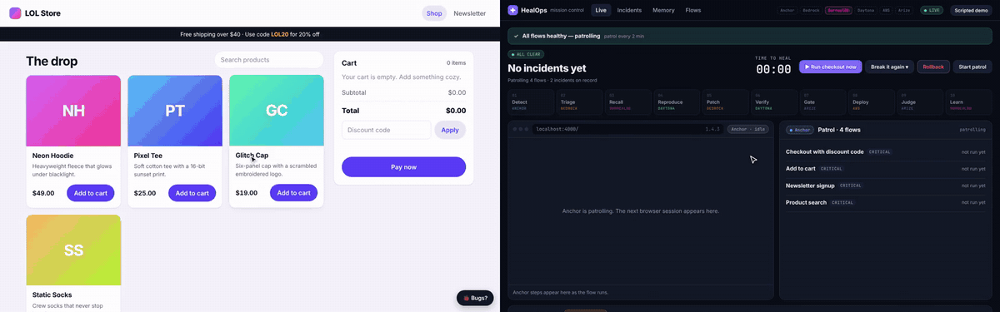

# HealOps: a self-healing QA engineer

HealOps patrols a web store with a browser. When a user flow breaks, it heals it on its own:
**detect → triage → recall → reproduce → patch → verify → gate → deploy → judge → learn**,
streamed live to a mission-control dashboard.

| Stage | Sponsor | Local fallback (no keys) |
|---|---|---|
| detect | Anchor Browser | local headless Chromium |
| triage, patch, judge | AWS Bedrock (Claude) | canned reference fix + heuristic judge |
| recall, learn | SurrealDB | embedded SurrealDB in `.healops/surreal` |
| reproduce, verify | Daytona | local sandbox directory |
| deploy | AWS S3 | local static host with canary/promote/rollback |
| traces, evals | Arize | in-process span recorder |

The demo runs end to end with **no keys**. If a sponsor call fails (e.g. expired AWS credentials), that stage falls back and the heal still completes.



*A shopper finds that the search box runs HTML (a reflected XSS) and flags it with the 🐞 widget; HealOps replays the flow, patches `js/app.js` and ships the fix in about 5 s. MP4: [docs/demo/flag-search-xss.mp4](docs/demo/flag-search-xss.mp4). Re-record with `node scripts/record-demo.mjs` (needs the server running with `HEALOPS_NO_PATROL=1 HEALOPS_INITIAL_SEED=search-xss`).*

## Run the demo

```bash
npm ci                       # or: bash scripts/cloud-setup.sh (also installs Chromium)
npm run build                # widget + dashboard
npm run dev                  # API :8787, dashboard :5173 (Vite), store :4000
```

Open http://localhost:5173 (or http://localhost:8787 to use the built dashboard), then:

1. **Break it again ▾** → pick a bug (e.g. *Discount code breaks checkout*, or *Search box runs HTML from the query (XSS)*). The bug is published to the live store and its flow runs right away.
2. Watch the 10 stages light up; click any stage to inspect it (sandbox logs, diff, risk gate, canary, judge score).
3. The store moves to a new patch version and the flow goes green. **Memory** shows the bug → fix graph; break it again and recall finds the earlier fix.

No server? Open the dashboard with `?demo=1` for a scripted incident.

Useful switches: `HEALOPS_LLM_PROVIDER=offline` (never call an LLM), `HEALOPS_NO_PATROL=1`, `HEALOPS_AUTONOMY=suggest` (every patch waits for **Approve**), `HEALOPS_FAKE=1` (fake runtime, no adapters).

## Check it

```bash
npm run typecheck
npx tsx scripts/e2e.ts checkout-discount     # also: signup-plus-email, cart-overlay, search-xss → ends HEALED
npx tsx apps/server/scripts/smoke.ts
npm run doctor                               # which sponsors are live
```

Secrets go in `.env` (see `.env.example`) and are never committed. Anchor's cloud browser can't reach localhost, so for live Anchor sessions expose the store with `npm run tunnel -- --write-env`.
